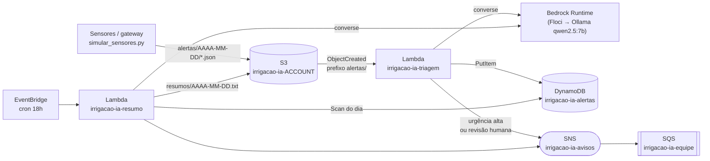

# Projeto integrador — Triagem de alertas de irrigação com IA generativa

**Tema:** agronegócio (Ribeirão Preto). Sensores de umidade do solo e de pressão dos pivôs geram alertas; a IA faz a
triagem de cada alerta na hora, avisa a equipe de campo quando é urgente e escreve um resumo diário para o gerente.

**Papéis da IA usados:** **componente** (Bedrock chamado pelas Lambdas) e **assistente** (assistente de IA de linha de comando e qwen2.5:7b usados
para gerar e revisar IaC, políticas e código, com os erros registrados no diário).

## Arquitetura



Tudo é criado por **um template CloudFormation** ([`template.yaml`](template.yaml)): bucket, tabela, tópico, fila, as duas
Lambdas, duas roles de menor privilégio, permissões e a regra agendada.

## Subir em poucos comandos

Pré-requisito: o ambiente da raiz do repositório no ar (`docker compose up -d`, `source env.sh`, modelo baixado).

```bash
cd projeto
./deploy.sh                              # cfn-lint + package + deploy (recusa rodar fora da conta 000000000000)
python simular_sensores.py               # envia 4 alertas
aws dynamodb scan --table-name irrigacao-ia-alertas --query 'Items[].[talhao.S,sensor.S,urgencia.S]' --output table
aws lambda invoke --function-name irrigacao-ia-resumo --cli-read-timeout 300 --payload '{}' \
  --cli-binary-format raw-in-base64-out resumo.json && cat resumo.json
Q=$(aws sqs get-queue-url --queue-name irrigacao-ia-equipe --query QueueUrl --output text)
aws sqs receive-message --queue-url $Q --max-number-of-messages 10      # o que a equipe recebeu
python test_triagem.py                   # testes sem Floci
./destruir.sh                            # apaga tudo
```

## Resultado (4 alertas simulados)

| Talhão | Sensor | Situação | IA disse | Final | Avisou a equipe? |
|---|---|---|---|---|---|
| 3 | umidade 27 % (faixa 22–35) | dentro | baixa | **baixa** | não |
| 5 | pressão 2,1 bar (faixa 2,5–4) | abaixo, queda lenta | media | **media** | não |
| 7 | pressão 0,6 bar, vazão +40 % | rompimento provável | alta | **alta** | sim |
| 9 | umidade 11 %, pivô parado 2 dias | muito abaixo | media | **alta** (piso de segurança) | sim |

Evidências: [`triagem`](../evidencias/projeto-triagem.png), [`mensagens na fila`](../evidencias/projeto-sns-sqs.png),
[`resumo diário`](../evidencias/projeto-resumo-diario.png), [`testes`](../evidencias/projeto-testes.png),
[`resumo v1 com erro`](../evidencias/projeto-resumo-v1-sem-regra.txt).

## Decisões de projeto

- **O código decide o que é número; a IA decide o que é texto.** A comparação valor × faixa (`situacao_faixa`) e um
  **piso de urgência** (fora da faixa ⇒ no mínimo `media`; desvio > 40 % ⇒ `alta`) são regras fixas. A IA escreve o resumo,
  sugere a ação e pode **subir** a urgência, nunca descer abaixo do piso. O campo `urgencia_ia` guarda o que o modelo disse,
  para auditoria.
- **Falha segura:** duas respostas inválidas viram `revisao_humana`, que também avisa a equipe.
- **Injeção de prompt:** o alerta vai delimitado em `<alerta>` e o prompt de sistema manda tratá-lo como dado (Etapa 6).
- **Menor privilégio:** a triagem só lê `alertas/*`, só faz `PutItem` na tabela e só publica no tópico; o resumo só faz
  `Scan`, só escreve em `resumos/*`. Ambas só podem invocar o modelo configurado.
- **Sem dados pessoais** nos alertas (só sensor, talhão e leitura).

## Custo e TI Verde

Média medida ([`resultados.tsv`](resultados.tsv)): **334 tokens de entrada e 50 de saída por alerta**. A análise completa está na [Etapa 6](../etapa6/README.md).

## Na AWS real

| Aqui (Floci) | Na AWS real |
|---|---|
| qwen2.5:7b local via proxy | Modelo do Bedrock habilitado na conta; `ModeloId` é parâmetro do template |
| Fila SQS como "caixa de entrada" | Assinatura SNS por e-mail/SMS ou integração com WhatsApp/Teams |
| Resumo invocado à mão na demonstração | Regra do EventBridge dispara às 18h (a regra já está no template) |
| IAM avaliado só com `IAM_ENFORCEMENT=true` | IAM sempre avaliado; CloudTrail registra cada chamada |
| Nada custa | Cada token, Lambda e mensagem custa (ver Etapa 6) |

## Diário de prompts

| Prompt / pedido | Resposta da IA | Erro encontrado | Correção |
|---|---|---|---|
| Prompt de triagem com critérios por nível + alerta do talhão 3 (27 %, faixa 22–35) | `urgencia: media` | Modelo de 7B não comparou o número com a faixa corretamente | `situacao_faixa` calculada no código e enviada ao modelo |
| Mesmo prompt + alerta do talhão 9 (11 %, pivô parado), segunda rodada | `urgencia: media` (na primeira rodada tinha dado `alta`) | Instabilidade: mesmo alerta, classificações diferentes entre rodadas | Piso de urgência determinístico; IA só pode subir |
| Prompt de resumo "primeiro o que exige ação, depois o restante" | Colocou só o talhão 7 em "Ação necessária" e o talhão 9 (`alta`) como "deve ser monitorada" | Resumo contradizia a triagem | Alertas ordenados por urgência no código + seções fixas (`Ação hoje / Próximos dias / Normal`) + "não mude a urgência" |
| (assistente) `cfn-lint --ignore-checks W3002 template.yaml` no `deploy.sh` | `E1001 'Resources' is a required property` | `--ignore-checks` aceita vários valores e consumiu o nome do arquivo | Arquivo antes da opção |
| (assistente) `deploy.sh` com `set -e` | Abortou depois do lint | `cfn-lint` sai com código ≠ 0 também para avisos (`W3002`, esperado com `package`) | Aviso ignorado explicitamente |
| (assistente) ação do alarme CloudWatch → SNS (teste para a Etapa 5) | Alarme foi para `ALARM`, nenhuma mensagem chegou | Limitação do Floci: ações de alarme não são entregues (nem com `set-alarm-state`); SNS → SQS sozinho funciona | Avisos do projeto publicados direto no SNS pela Lambda |
